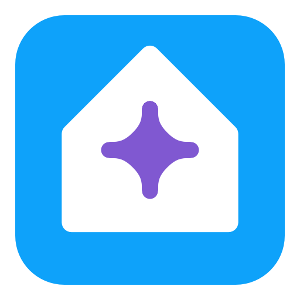

# HA+ Apps

Home Assistant Apps

## HA+ Matter Hub

The Matter Hub app uses the versioned container image published by
[ha-plus-matter-hub](https://github.com/zvikarp/ha-plus-matter-hub). Its manifest and changelog are synchronized from the
latest stable GitHub Release after the matching GHCR image is available.

## BroadLink IR Remote Mapper

[Installation and configuration](broadlink-ir-mapper/README.md) for the
Home Assistant integration with guided IR learning and a HA+ control panel. Source lives under
`custom_components/broadlink_ir_mapper`; this is an integration, not an add-on.
